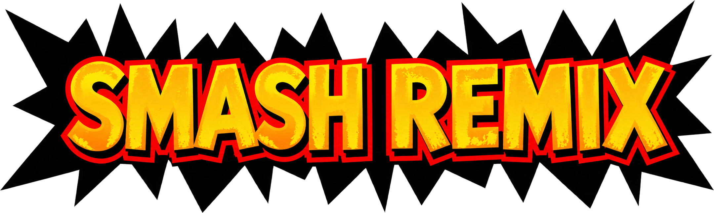

<p align="center">
  
</p>

# BattleShip-Remix

> [!WARNING]
> **This is a community fork of [BattleShip](https://github.com/JRickey/BattleShip) that ports Smash Remix.** It is not made, endorsed or supported by
> the BattleShip author, the Smash Remix team or the Harbour Masters. Please **do not** open issues on their repositories or ask for help in their
> channels for anything you hit while building or playing this fork: report it on [this repository's issue tracker](https://github.com/lucasliet/BattleShip-remix/issues).

**BattleShip-Remix** is a native PC and Switch port of **[Smash Remix](https://github.com/JSsixtyfour/smashremix) 2.0.1**, the Super Smash Bros. (N64) mod, built on the [BattleShip](https://github.com/JRickey/BattleShip) port. BattleShip turns the [VetriTheRetri/ssb-decomp-re](https://github.com/vetritheretri/ssb-decomp-re) decompilation into a native program with [libultraship](https://github.com/Kenix3/libultraship) (rendering, audio, input) and [Torch](https://github.com/HarbourMasters/Torch) (asset extraction). This fork rewrites the Remix's MIPS assembly as C on top of that decompilation, so the Remix runs as native code instead of patches on an emulated ROM.

What the port covers:

- every Remix 2.0.1 fighter (97 fighter ids, including the Remix clones, Polygons and bosses), stage, hazard and custom item;
- the Remix modes: Remix 1P, All-Star, Multi-Man, Cruel, Home-Run Contest, Bonus 3, King of the Hill, Smashketball, Tag Team, Stamina, Tug of War, 12-Character Battle, the Remix Training mode;
- the Remix menus and screens: the character select panel and its options, the Remix settings and toggles (in the port menu), Character Data, Sound Test, Gallery, credits, results and Match Stats;
- the Remix audio banks (music and voices) and the CPU AI changes.

The few places where the port deliberately behaves differently from the assembly are listed in [`docs/remix/deviations.md`](docs/remix/deviations.md). The Remix screens are authored for 4:3: the optional Widescreen setting only widens battle scenes, and menus stretch.

[Releases](https://github.com/lucasliet/BattleShip-remix/releases) ship **macOS (Apple Silicon, .dmg)**, **Linux (x86_64 AppImage)**, **Windows (x64 .zip)**, **Nintendo Switch (homebrew .nro)**, **Android (arm64 .apk)** and **PlayStation 5 (homebrew title folder)** packages, and the built-in updater of every platform follows them. The vanilla BattleShip build (US Super Smash Bros.) still compiles from the same tree with `-DSSB64_VERSION=us`.

## No copyrighted assets are included in this repository

**None of Nintendo's assets (code, textures, audio, models, text, ROM data), and no Smash Remix ROM data, are checked into this repo or distributed with builds.** Every byte of game data is extracted on the first run from ROMs that *you* supply. If you do not own a legal copy of Super Smash Bros. for the Nintendo 64, you cannot build or run this project.

The Remix needs only the Smash Remix 2.0.1 ROM, made from your own US ROM with the [Smash Remix web patcher](https://smashremix.net/patcher/) or the patch from the [Smash Remix releases](https://github.com/JSsixtyfour/smashremix/releases). A release asks for it on the first launch; a source build reads it from the repository root:

| File | ROM | SHA-1 | MD5 |
|------|-----|-------|-----|
| `baserom.remix.z64` | Smash Remix 2.0.1 (internal name `SMASH REMIX`, game code `NALE`) | `13716381ed5e29be2606e0f4724b18fd00789d04` | `2b2d6b295106c54216b7fc7a2f14346e` |

The US ROM the patch is applied to is Super Smash Bros. NTSC-U v1.0 (`NALE`, SHA-1 `e2929e10fccc0aa84e5776227e798abc07cedabf`, MD5 `f7c52568a31aadf26e14dc2b6416b2ed`). A source build can also take it as `baserom.us.z64` (optional: dev-only stage images and the Remix source assembly script).

The vanilla builds need only their own ROM: US as above, or JP (Nintendo All-Star! Dairantou Smash Brothers v1.0, `NALJ`, SHA-1 `4b71f0e01878696733eefa9c80d11c147ecb4984`, MD5 `66db457b130d31a286a23d6e4dd9726e`) with `-DSSB64_VERSION=jp`. A dump that does not match the hashes for its version will not work.

## PlayStation 5

The PS5 build is a native homebrew title (`PPSA99264`, built with ps5-payload-dev's SDK and ps5-opengl) for a
jailbroken console with ShadowMountPlus. Unzip the release's `BattleShip-Remix-ps5-PPSA99264.zip` to `/data/homebrew/`
(or an external drive) and copy your `baserom.remix.z64` into `PPSA99264/`; the first launch extracts
`BattleShip-Remix.o2r` there. Everything the game writes (archive, saves, settings, `logs/`) stays in that folder.
L3+R3 opens the port menu. Build steps: [`docs/remix/build_and_roms.md`](docs/remix/build_and_roms.md#ps5-build-battleship-remix).

## Nintendo Switch

The Switch build is a homebrew `.nro` (libnx). The console does not read the ROM: `BattleShip-Remix.o2r` is the one the desktop build
extracted from your ROM, copied to the SD card. Folder layout on the SD card:

```
sdmc:/switch/BattleShip-Remix/
├── BattleShip-Remix.nro
├── BattleShip-Remix.o2r          (from your desktop build)
├── BattleShip-Remix.o2r.recipe   (from your desktop build)
├── f3d.o2r
├── config.yml
├── gamecontrollerdb.txt
├── README.txt
└── assets/
```

- Launch it from the Homebrew Menu in **full-memory mode** (hold R while opening an installed game, or use a forwarder). Applet mode does not
  have enough memory.
- Always copy `BattleShip-Remix.o2r` **and** `BattleShip-Remix.o2r.recipe` together, from a desktop build of the **same release** as the `.nro`. The game compares the recipe in the `.recipe` file with the one inside the `.nro` and refuses to start on a mismatch (or if the `.recipe` is missing). Some releases keep the same recipe, so an older `.o2r` can still work; when it does not, the error screen shows both recipes. After an update that changes the asset pipeline, extract again with the new desktop build and copy both files again.
- The game writes `ssb64.log` and `logs/BattleShip-Remix.log` next to the `.nro`, both overwritten on every launch; attach them to any Switch bug report.
- Build and packaging steps: [`docs/remix/build_and_roms.md`](docs/remix/build_and_roms.md#switch-build-battleship-and-battleship-remix).

## How the Remix port was done and validated

- **Plan and history:** [`docs/remix/ROADMAP.md`](docs/remix/ROADMAP.md), milestone by milestone, with the evidence of each task.
- **Method:** [`docs/remix/porting_guide.md`](docs/remix/porting_guide.md) (reading the Remix source, resolving addresses, the hook convention for vanilla code) and [`docs/remix/architecture.md`](docs/remix/architecture.md).
- **Patch audit:** every `OS.patch_start` of the Remix source (2007), its 80 direct `origin` writes and its 988 character-table patches were mapped to the decomp function they land in (`tools/audit_remix_patches.py`) and compared with the port by hand. Each gap got a ledger ID and was closed with a test ([`docs/remix/patch_audit.md`](docs/remix/patch_audit.md), [`docs/remix/patch_audit_scopes.md`](docs/remix/patch_audit_scopes.md)); [`docs/remix/parity.md`](docs/remix/parity.md) is the per-file summary.
- **Tests:** unit tests for the pure rules (`tests/remix/`), headless in-game smoke tests driven by input scripts (the `remix-smoke-tests` skill in `.claude/skills/`: VS matches, special-move matrices, stage and item sweeps, CSS and mode flows, audio dumps), and screen comparisons against the real Remix ROM in a reference emulator ([`docs/remix/notes/i8_reference_emulator.md`](docs/remix/notes/i8_reference_emulator.md)).
- **Reference docs:** [`docs/remix/README.md`](docs/remix/README.md) indexes how each Remix subsystem works and how the port implements it.

## Features

Everything below comes from BattleShip and is toggleable in-game from the ESC menu. The Remix adds its own settings pages (Remix, Gameplay, Music, Stage and Pokemon) to the same menu.

### Input enhancements (per-player)

- **Disable Tap Jump**
- **C-Stick Smash**
- **D-Pad to Jump**
- **NRage analog-stick remap** with customizable per-axis ranges

### Gameplay & match options

- **Classic Co-op** — play the originally single-player Classic mode with 2-player local co-op, with an optional friendly-fire toggle
- **Z-Cancel assists** — Auto Z-Cancel and Flash on Failed Z-Cancel (L-cancel practice aids)
- **Competitive ruleset** — one-click tournament rules, plus neutral spawns on Dream Land
- **Disable Stage Hazards**
- **Hitbox view** — visualize hitboxes / hurtboxes / collision
- **Boot straight to the VS character-select screen**, **Skip Results Screen**, **Force CPU Level 9**
- **Unlocks** — unlock everything, or individual characters (Captain Falcon, Jigglypuff, Luigi, Ness) and features (Mushroom Kingdom, Item Switch menu, Sound Test)

### Audio

- **Music shuffler** — randomize stage BGM
- **Music selection screen** — pick the track per stage
- Independent Master / Music / Sound / Voice volume sliders

### Rendering (powered by libultraship / Fast3D)

- Internal resolution scaling, MSAA anti-aliasing, three-point texture filtering
- Optional widescreen for battle scenes, including ultrawide resolutions (menus stretch; off by default on the Switch)
- Renderer backend selection (OpenGL / Metal / Direct3D), VSync, windowed-fullscreen, multi-window
- **Post-process shader support** with an in-app shader-pack downloader

### Textures & mods

- **Hi-res texture packs** on desktop *and* Android (opt-in, read in place straight out of a `.zip`). Download GhostlyDark's pack from [evilgames.eu](https://evilgames.eu/texture-packs/ssb-reloaded.htm#pc).
- **Native C mod support** — write mods in C, compiled at runtime (TinyCC), with hot-reload, function detours, and a documented engine/fighter event catalog. See [`docs/modding.md`](docs/modding.md). *(Desktop only; scripting is disabled on Android.)*

### Controls

- Controller and rumble support powered by **SDL2**, with plug-and-play routing for up to 4 pads
- Native **Raphnet** adapter support up to 4 channels through **hidapi**
- Native **GameCube adapter** support (WUP-028 and compatible clones) over **libusb**, driven directly rather than through SDL — all 4 adapter ports, hotplug, and fully remappable like any other device. Each adapter port feeds the matching player by default and can be reassigned to any player. *(Desktop only. On Windows the adapter must be bound to the WinUSB driver.)*
- Per-controller configuration UI and a bundled `gamecontrollerdb.txt` mapping database

### Platform & quality-of-life

- Runs natively on **macOS (Apple Silicon), Linux, Windows, Android, Nintendo Switch and PlayStation 5**
- First-run ROM-extraction wizard, built-in update checker/downloader, and Discord Rich Presence

### Rollback netcode & online play

Work in progress.

## About the BattleShip port

BattleShip, the port this fork builds on, was created by [JRickey](https://github.com/JRickey). From its author:

> This is a project that I started and developed alone with Claude until the v0.3-beta release. It took a little over a month of night and day work to get to the first beta release, and a massive 4 day long sprint working all day resolving bugs from v0.3-beta to v0.7-beta. As of now, this is no longer a pure AI project. Many people have offered their time playtesting, their knowledge of the game, or their experience with modding or competitive play; to bring improvements, bug fixes, new feature suggestions, and additions. Without them, the project would not be what it is today.
>
> If you find anything that you would like to see improved, create an issue on Github. I'll fix it.
>
> This port was started when the original decomp was 96% complete code only. The remaining 4% was the internal debug menu and Libultra functions that aren't necessary to port the game. The relocatable data was also not decompiled at the time. The port was designed with this in mind, and it is why certain design decisions had to have been made. I like to move fast, obviously.
>
> This project uses a heavily modified LibUltraShip and Torch, those two modules obviously don't work with every n64 game out of the box and a lot of game specific things needed to be implemented. The original game is quite unique and uses rendering techniques and n64 hardware tricks in ways other LUS projects did not need to account for.
>
> This is a passion project for me. Not out of nostalgia, but to actually make something. I don't have too much nostalgia for the original game, considering I didn't own a copy as a kid, but I remember playing it at a friend's house a handful of times. What motivates me to work on this is because I can. Because it's hard, because it hasn't been done before (at least not open source). It's required a ton of my personal time, even using AI. It's forced me to get creative, to design custom tools, to force the agents into certain boxes.
>
> People may not like it because I used AI, and that's okay. I'm not going to argue with your opinion or try to say that my way is the correct way of doing things. It works for me and that's what matters to me. My code is open source, it's free, it's MIT Licensed, and everyone can learn from it. That's what should matter to you.
>
> I hope you enjoy the project.

---

## Building

The Remix build (ROMs, assets, desktop, Switch, Android and PS5) is described in [`docs/remix/build_and_roms.md`](docs/remix/build_and_roms.md). The generic BattleShip steps (including Windows) are in [BUILDING.md](BUILDING.md).

## Architecture

The port has three layers and they are kept deliberately separate:

```
┌──────────────────────────────────────────────────────────────┐
│  decompiled game code  (decomp/src/)                         │
│  Unmodified C produced by the decomp project. Talks to the   │
│  N64 the same way the original ROM did: GBI display lists,   │
│  ALSeqPlayer audio, OS threads, OSContPad input.             │
├──────────────────────────────────────────────────────────────┤
│  port layer            (port/)                               │
│  Modern C++ glue. Translates N64-shaped APIs into LUS calls, │
│  fixes endianness on freshly-loaded data, owns Ship::Context │
│  and the resource factories, and quarantines every change    │
│  the decomp doesn't need to know about.                      │
├──────────────────────────────────────────────────────────────┤
│  libultraship         (libultraship/)                        │
│  PC-native runtime: Fast3D renderer (OpenGL / Metal / D3D),  │
│  SDL2 input, miniaudio output, OTR/O2R resource manager,     │
│  ImGui overlay.                                              │
└──────────────────────────────────────────────────────────────┘
```

### Asset pipeline

The ROM is never read at runtime. **Torch** walks it with the YAMLs under `yamls/<version>/` and emits the game archive (`BattleShip-Remix.o2r` for the Remix, `BattleShip.o2r` for vanilla) — a zip-format archive of typed resources (textures, sequences, sample banks, animations, reloc files). A release does this on the first launch from the ROM you supply; a source build does it during the build. At launch, libultraship's resource manager mounts the archive + `f3d.o2r` and the port code requests resources by path. A `.recipe` file next to the archive records which Torch revision, `config.yml` and YAMLs produced it, so the game re-extracts when they change. This is the same pipeline used by Ship of Harkinian, Starship, SpaghettiKart, etc.

The relocatable-data files (fighter tables, item tables, effects, sprites) are SSB64-specific and required custom factories on the Torch side and a custom loader (`port/resource/RelocFileFactory.cpp`) on the runtime side.

### Build-time codegen

A small amount of generated code lives outside the source tree (gitignored) and is regenerated on every build from `tools/reloc_data_symbols.us.txt`:

- `include/reloc_data.h` — extern declarations for every relocatable symbol
- `yamls/us/reloc_*.yml` — Torch extraction configs
- `port/resource/RelocFileTable.cpp` — the runtime symbol table

If you ever see "undefined reference to `dFooBarReloc`" you regenerated the table without rebuilding, or vice versa.

---

## Code conventions

### `#ifdef PORT` — what it is and what it isn't

Every meaningful change to a decomp source file is wrapped in `#ifdef PORT` / `#else` / `#endif`. The discipline this enforces:

- **The original decomp code path stays intact and compilable** under the IDO toolchain on a real N64 build. This is non-negotiable — if it ever stops being true, upstreaming improvements back to the decomp project becomes impossible.
- **The PORT branch is allowed to be ugly** — an explicit endian conversion, a struct rewrite, a function shim — as long as the contract it presents to the rest of the file is the same as the N64 branch.
- **Reloc tokens vs. raw pointers**: a field declared `u32` under `#ifdef PORT` where the N64 branch declared `T*` is a *reloc token*, not a raw pointer. Resolving it requires `PORT_RESOLVE(token)`. Assigning a real pointer with `(uintptr_t)ptr` will silently truncate on LP64 — wrap post-load writes in `PORT_REGISTER`.

### Decomp preservation: behavior, not bytes

The repo follows a single principle for changes to `decomp/src/`:

> **Accuracy to game behavior > accuracy to ROM bytes.**

That means IDO idioms that encode original N64 semantics — odd casts, `goto` flow, deliberate temporaries — are load-bearing and stay. But **compiler-compat shims** (warning suppressions, permissive flags, header shortcuts) that mask real bugs on modern LP64 toolchains do *not* survive. The most expensive lesson of the project was that `-Wno-implicit-function-declaration` was silently truncating 64-bit pointer returns to 32-bit `int` in dozens of places. The shim is gone; the real declarations are in.

### Naming prefixes

The decomp uses two-letter module prefixes throughout. Knowing them makes the source tree navigable:

| Prefix | Meaning |
|--------|---------|
| `ft`   | Fighter (`ftMario`, `ftKirby`, `ftFox`, …) |
| `it`   | Item (`itAttribute`, `itManager`) |
| `wp`   | Weapon |
| `ef`   | Effect / particle |
| `gm`   | Game mode |
| `gr`   | Stage (ground) |
| `mp`   | Map / collision |
| `mn`   | Menu |
| `sc`   | Scene |
| `sy`   | System (engine internals) |
| `sf`   | Saved-state / save file |
| `db`   | Debug |
| `cm`   | Camera |
| `lb`   | Library (low-level utilities) |
| `obj`  | GObj / DObj / OMObj — game-object wrappers |

### Endianness handling

The N64 is big-endian; PC targets are little-endian. The port handles this in three layers:

1. **Gross byteswap at load** — `lbRelocLoadAndRelocFile` byteswaps relocatable files word-by-word during load.
2. **Per-struct fixups** — small `portFixupStructU16` / `portFixupStructU8` helpers fix sub-word fields that the gross swap got wrong (e.g., `{u16, u8, u8}` patterns where the two `u8`s end up swapped).
3. **Per-stream walkers** — animation events, spline interpolators, and other variable-length streams are halfswapped at file-bake time and need a per-stream un-halfswap on first access. These live in `port/port_aobj_fixup.{h,cpp}` and friends.

If you find a new struct that reads garbage, work out which of the three layers it belongs in before patching the reads.

### Bitfield layout

The IDO compiler packs small bitfields into preceding `u16` pad gaps, MSB-first. Modern compilers (Clang, GCC) on LE targets pack LSB-first into the next storage unit. Bitfield structs that travel through file data must be **rewritten under `#ifdef PORT`** to match the IDO physical layout (compile the original with IDO and disassemble with rabbitizer to verify the bit positions before porting).

Patching the *reads* in game code instead of the *layout* is forbidden by team policy; the bug always comes back.

---

## Why the submodules are forks

`decomp`, `libultraship` and `torch` point at the `-remix` forks ([ssb-decomp-re-remix](https://github.com/lucasliet/ssb-decomp-re-remix), [libultraship-remix](https://github.com/lucasliet/libultraship-remix), [Torch-remix](https://github.com/lucasliet/Torch-remix), branch `feature/remix-port`). They are forks of the BattleShip forks below and add the Remix work: the Remix C code and hooks in the decomp, the Remix asset factories in Torch, and the runtime fixes the Remix needed in libultraship.

The BattleShip forks exist because each dependency needs SSB64-specific changes that don't exist upstream.

### [`libultraship`](https://github.com/JRickey/libultraship/tree/ssb64) — fork of [Kenix3/libultraship](https://github.com/Kenix3/libultraship)

SSB64 drives the RDP differently than the Zelda / Mario 64 / Star Fox 64 titles libultraship was originally built for — in particular around tile masks, `SetTileSize` extents, IA/I4 texture uploads, `gDPSetPrimDepth` for 2D layering, and Metal sampler binding for matanim CCs. Upstreaming the fixes is on the list, but until then the fork carries:

- Clamping `ImportTexture*` upload width/height to the active `SetTileSize` extent (fixes the fighter "black squares" bug and the IA8/I4 stretch bug)
- Honouring `SetTile` mask/maskt in the Import* path
- A real implementation of `gDPSetPrimDepth` (was a `TODO Implement` stub upstream — broke every `G_ZS_PRIM` 2D sprite)
- A 1×1 black fallback texture for sampler slots that would otherwise alias the screen drawable on Metal (fixed the Whispy canopy stripe)
- A no-logging path in `IResource`'s destructor to prevent a shutdown-time crash

### [`torch`](https://github.com/JRickey/Torch/tree/ssb64) — fork of [HarbourMasters/Torch](https://github.com/HarbourMasters/Torch)

Torch is the tool that reads the ROM and emits `BattleShip.o2r`. Upstream supports OoT, MM, SF64, MK64, PM64, etc., but has no knowledge of SSB64's file formats. The fork adds:

- An `SSB64` build flag and game target
- A reloc-file factory for SSB64's relocatable data blobs (fighters, items, effects, sprites)
- `libvpk0` integration for VPK0-compressed segments

Both forks live as submodules so their history stays their own and so upstream changes can be merged in cleanly when/if the fixes are accepted.

---

## Repo layout

```
port/         modern C++ port layer — Ship::Context, resource factories,
              endian fixups, bridges between decomp code and libultraship
                port/hooks/     engine/fighter event system (all platforms)
                port/mods/      native C mod loader + hook backend (funchook)
workspace/    worked example mods (hooktest, playertint, template)
include/      headers (some generated: reloc_data.h)
decomp/       submodule — decompiled SSB64 C source (largely unchanged
              game logic). Major subdirs inside the submodule:
                src/sys/        main loop, DMA, scheduling, audio,
                                controllers, threading
                src/ft/         fighters (ftmario/, ftkirby/, ftfox/, …)
                src/sc/ gm/ gr/ scene / game modes / stage rendering
                src/mn/ it/ ef/ menus / items / effects
                src/relocData/  reloc data sources
libultraship/ submodule — PC-native render / audio / input / resource mgr
torch/        submodule — asset extractor (ROM → BattleShip.o2r)
yamls/us/     Torch YAML extraction configs (some generated)
tools/        Python helpers: reloc stubs, YAML gen, credits encoder
docs/         build guide, deviations from the Remix, modding guide, developer notes
debug_tools/  optional disasm / diff utilities (not required for a build)
scripts/      packaging (.dmg / .AppImage / .zip), worktree helper
```

### Further reading

- [`BUILDING.md`](BUILDING.md) — prerequisites and generic build steps (Linux, macOS, Windows)
- [`docs/remix/build_and_roms.md`](docs/remix/build_and_roms.md) — ROMs and hashes, and the desktop, Switch, Android and PS5 build and packaging steps
- [`docs/remix/deviations.md`](docs/remix/deviations.md) — where the port deliberately differs from the Remix assembly
- [`docs/modding.md`](docs/modding.md) — writing native C mods: the event catalog, function detours, and fighter override points

---

## Contributing

PRs are welcome from anyone. Bugs go through the [issue form](https://github.com/lucasliet/BattleShip-remix/issues/new/choose), which asks for what we need to act on a report:

- Platform and game version (the "Version" line in the game menu); on Switch, also where the `.o2r` was generated
- The exact fighter, stage and mode, and the steps to reproduce it
- A screenshot for a graphics bug, or a video of the move for a gameplay bug
- `ssb64.log` and `logs/BattleShip-Remix.log` from the run that reproduces the issue (both are overwritten on every launch, so copy them before opening the game again); on PS5 also `boot.txt`
- SHA-1 of your ROM if extraction fails

## Credits & licensing

- Game code, data, sound, textures, models, and trademarks: **© Nintendo / HAL Laboratory.** Not included in this repository, not redistributed, and not endorsed by them.
- Decompilation: [VetriTheRetri/ssb-decomp-re](https://github.com/VetriTheRetri/ssb-decomp-re) and its contributors. Vendored as the `decomp/` submodule. At the time of writing the upstream project does not publish an explicit license; this repository makes no copyright claim over the decompiled source and refers to the upstream project for any rights, terms, or restrictions on reuse.
- Runtime framework: [libultraship](https://github.com/Kenix3/libultraship) — Copyright (c) 2022 kenix3, MIT-licensed. Originated by the Harbour Masters team (Ship of Harkinian) and now maintained at Kenix3/libultraship. Vendored as the `libultraship/` submodule.
- Asset pipeline: [Torch](https://github.com/HarbourMasters/Torch) — Copyright (c) 2023 Lywx (Harbour Masters), MIT-licensed. Vendored as the `torch/` submodule.
- Menu fonts: [Montserrat](https://github.com/JulietaUla/Montserrat) and [Inconsolata](https://github.com/cyrealtype/Inconsolata), both bundled under the [SIL Open Font License 1.1](https://openfontlicense.org). License texts ship alongside the font files in [`assets/custom/fonts/`](assets/custom/fonts/).
- Controller mappings: [`gamecontrollerdb.txt`](gamecontrollerdb.txt) from the [SDL_GameControllerDB](https://github.com/mdqinc/SDL_GameControllerDB) project — bundled with every build and loaded at startup so more controllers work out of the box. Distributed under the zlib license; full text in [`LICENSE`](LICENSE).
- High-resolution texture pack: *SSB Reloaded* by [GhostlyDark](https://github.com/GhostlyDark), distributed separately at [evilgames.eu](https://evilgames.eu/texture-packs/ssb-reloaded.htm#pc). Not bundled with this repository or its builds — the port loads it only if you download it yourself.
- Reference ports I learned from and adapted code from: [Starship](https://github.com/HarbourMasters/Starship) (SF64) and [Ship of Harkinian](https://github.com/HarbourMasters/Shipwright) (OoT) — both MIT-licensed by The Harbour Masters; see [`LICENSE`](LICENSE) for the per-file attribution.
- Reference ports I learned from but did not borrow code from: [SM64 PC Port](https://github.com/sm64-port/sm64-port) (SM64), [SpaghettiKart](https://github.com/HarbourMasters/SpaghettiKart) (MK64).
- Smash Remix: [the Smash Remix team](https://github.com/JSsixtyfour/smashremix) — the mod this fork ports; its source was the reference for every routine. No Remix ROM data is included.
- BattleShip port: [JRickey](https://github.com/JRickey), with an enormous amount of help, debugging, and feature suggestions from contributors in our Discord server.

This project is **not affiliated with, endorsed by, or authorized by Nintendo.** It is a personal, non-commercial research and preservation effort. Do not upload ROMs, extracted `.o2r` archives, or any other Nintendo-owned data to issues or pull requests.

This project is **not affiliated with, endorsed by, or authorized by Harbour Masters** either. It uses libultraship (originated by the Harbour Masters team and now maintained at [Kenix3/libultraship](https://github.com/Kenix3/libultraship)) and Torch (the [HarbourMasters/Torch](https://github.com/HarbourMasters/Torch) asset extractor) as upstream dependencies via personal forks, but it is an independent fan effort. Issues, bugs, and support questions about this port should not be directed to the Harbour Masters team.

## License

Source code in this repository (everything outside the `decomp/`, `libultraship/`, and `torch/` submodules — each of which carries its own attribution) is released under the [MIT License](LICENSE) — free to use, modify, and redistribute, with no warranty and no liability. See [`LICENSE`](LICENSE) for the full text.

The MIT grant covers only the port-specific code (the `port/` layer, build scripts, tools, docs). It does **not** extend to:
- Game assets, code, audio, textures, models, or any other content owned by Nintendo / HAL Laboratory — none of which is in this repository.
- The decompilation vendored as the `decomp/` submodule, sourced from [VetriTheRetri/ssb-decomp-re](https://github.com/VetriTheRetri/ssb-decomp-re). The upstream project does not currently publish an explicit license; this repository makes no copyright claim over the decompiled source and incorporates it by reference. Defer to the upstream project and its contributors for any rights or restrictions on reuse.
- Decomp-derived content elsewhere in the tree (vendored or auto-generated from the decomp's symbol/file-name tables): `tools/reloc_data_symbols.us.txt`, `tools/relocFileDescriptions.us.txt`, `include/reloc_data.h`, `port/resource/RelocFileTable.cpp`, and `yamls/us/reloc_*.yml`. These follow the same upstream-deference as the `decomp/` submodule. The generator scripts that produce them (`tools/generate_*.py`) are port-authored and remain MIT.
- The `libultraship` submodule — Copyright (c) 2022 kenix3, MIT-licensed (originated by the Harbour Masters team).
- The `torch` submodule — Copyright (c) 2023 Lywx (Harbour Masters), MIT-licensed.
- The bundled menu fonts under `assets/custom/fonts/`, which are licensed under the SIL Open Font License 1.1 (per-font license files in that directory).
- The bundled controller-mapping database `gamecontrollerdb.txt`, from the [SDL_GameControllerDB](https://github.com/mdqinc/SDL_GameControllerDB) project — distributed under the zlib license. Full text and attribution in [`LICENSE`](LICENSE).
